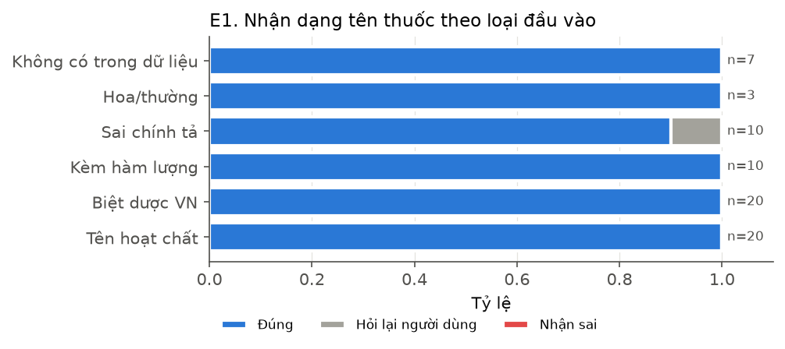
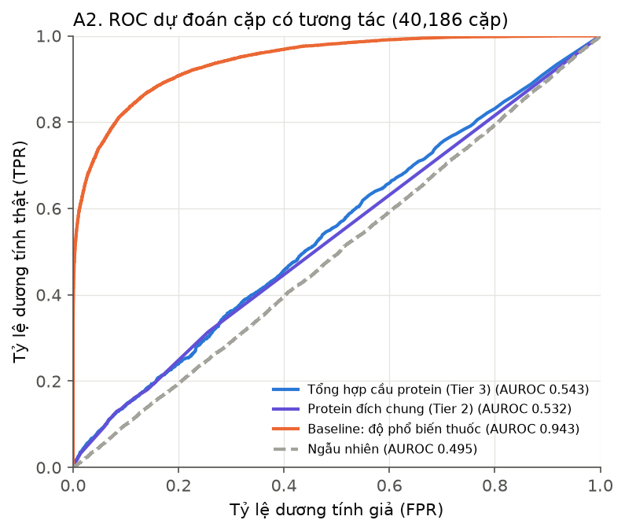
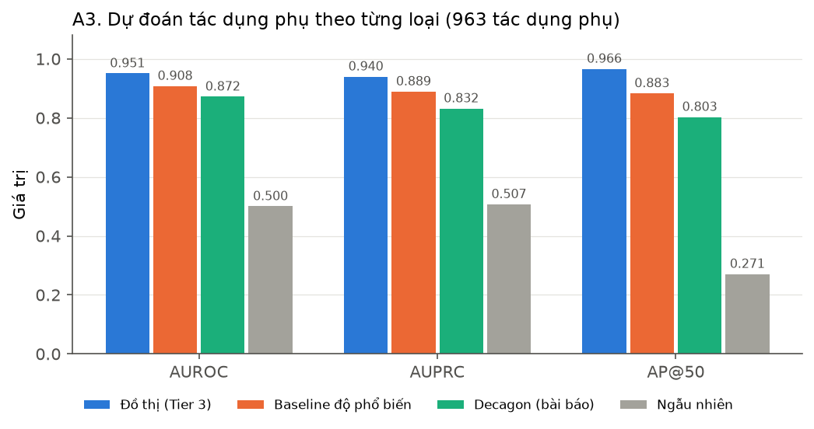
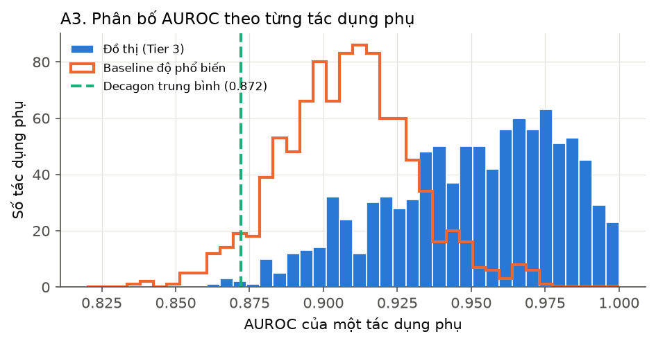
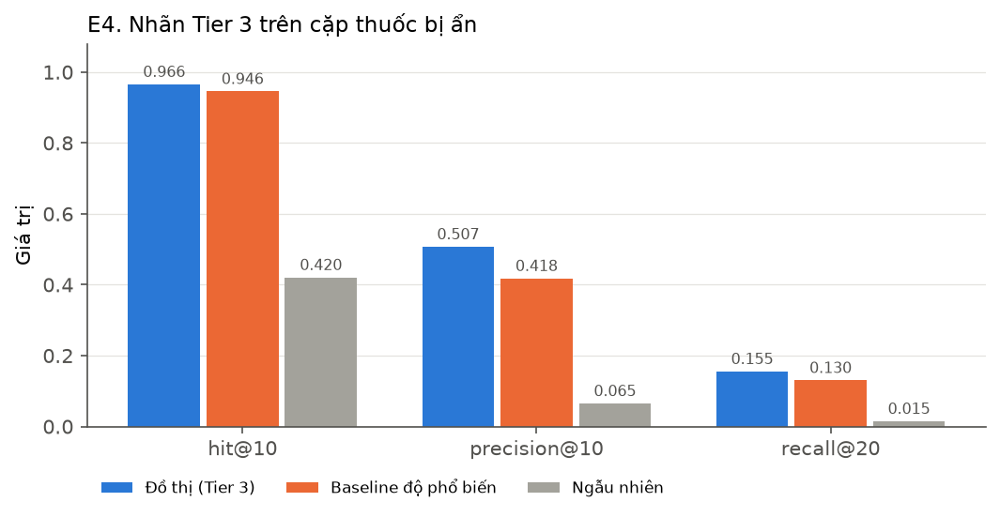

# Kết quả đánh giá độ chính xác

Sinh tự động bởi `python eval/run_offline.py` và `python eval/run_accuracy.py` (seed 0). Không có bước nào gọi LLM. Hình nằm trong `figures/`.

## E1. Nhận dạng tên thuốc

70 câu nhập (generic, biệt dược VN, kèm hàm lượng, sai chính tả, thuốc không có trong dữ liệu). Độ chính xác **98.6%**, nhận sai **0**, hỏi lại 1.

| Loại | n | Đúng | Hỏi lại | Sai |
|---|---|---|---|---|
| Tên hoạt chất | 20 | 100.0% | 0 | 0 |
| Biệt dược VN | 20 | 100.0% | 0 | 0 |
| Kèm hàm lượng | 10 | 100.0% | 0 | 0 |
| Sai chính tả | 10 | 90.0% | 1 | 0 |
| Hoa/thường | 3 | 100.0% | 0 | 0 |
| Không có trong dữ liệu | 7 | 100.0% | 0 | 0 |

## A1. Độ trung thực của kết quả so với dữ liệu gốc

200 phác đồ ngẫu nhiên (3–6 thuốc). Mọi kết quả được đối chiếu lại với các file CSV gốc, đọc độc lập với cache SQLite.

| Kiểm tra | Đạt | Tổng | Tỷ lệ |
|---|---|---|---|
| Tier 1 – precision: tác dụng phụ trả về có trong combo CSV | 52880 | 52880 | 100.0% |
| Tier 1 – recall: tác dụng phụ trong CSV của các cặp được trả về | 52880 | 52880 | 100.0% |
| Tier 2 – precision: cặp gắn Tier 2 thỏa quy tắc protein chung | 72 | 72 | 100.0% |
| Tier 2 – recall: cặp thỏa quy tắc được gắn Tier 2 | 72 | 72 | 100.0% |
| Tier 1 – đường dẫn bằng chứng đúng từng cạnh | 36145 | 36145 | 100.0% |
| Tier 2 – đường dẫn bằng chứng đúng từng cạnh | 1203 | 1203 | 100.0% |
| Tier 3 – đường dẫn bằng chứng đúng từng cạnh | 3181 | 3181 | 100.0% |

## A2. Dự đoán cặp thuốc có tương tác từ đồ thị protein

Tất cả 40186 cặp giữa các thuốc có protein đích; nhãn dương = cặp có dữ liệu trong `bio-decagon-combo` (14247 cặp). Các đặc trưng chỉ dùng targets + PPI, không dùng dữ liệu combo. Lưu ý: cặp "chưa có dữ liệu" không chắc là không tương tác.

| Đặc trưng | AUROC | AUPRC | Tỷ lệ cặp có | Tỷ lệ tương tác khi có | Tỷ lệ tương tác khi không | Lift |
|---|---|---|---|---|---|---|
| Protein đích chung (Tier 2) | 0.532 | 0.397 | 0.2764 | 0.4024 | 0.3362 | 1.135 |
| Cầu 1 bước (đích A ↔ đích B) | 0.543 | 0.3985 | 0.5912 | 0.3809 | 0.3163 | 1.075 |
| Cầu 2 bước (qua protein trung gian) | 0.5367 | 0.3983 | 0.9566 | 0.3567 | 0.3077 | 1.006 |
| Tổng hợp cầu protein (Tier 3) | 0.5434 | 0.4022 | 0.9567 | 0.3567 | 0.3069 | 1.006 |
| Baseline: độ phổ biến thuốc | 0.9428 | 0.9193 |  |  |  |  |
| Ngẫu nhiên | 0.4952 | 0.3505 |  |  |  |  |

**Diễn giải.** Cầu protein có ở 95.7% số cặp nên gần như không phân biệt được (AUROC 0.5434, lift 1.006), trong khi chỉ biết thuốc nào được báo cáo nhiều đã đạt AUROC 0.9428. Vì vậy Tier 3 chỉ được trình bày là *giả thuyết cơ chế* cần kiểm chứng, không phải dự báo nguy cơ; hệ thống không dùng sự tồn tại của cầu protein để kết luận một cặp thuốc có tương tác.

## A3. Dự đoán từng loại tác dụng phụ (giao thức Decagon)

Mỗi tác dụng phụ có ≥ 500 cặp: ẩn 10% số cạnh làm tập kiểm tra, mỗi cạnh dương ghép với một cặp âm ngẫu nhiên không có tác dụng phụ đó. Điểm của phương pháp chỉ tính trên phần huấn luyện. Dòng Decagon lấy từ bài báo (GCN, cùng dữ liệu nhưng cách chia khác) — chỉ để tham chiếu.

| Phương pháp | Số TDP | AUROC | AUPRC | AP@50 |
|---|---|---|---|---|
| Đồ thị: bộ chấm nhãn Tier 3 (số lần) | 963 | 0.9509 | 0.94 | 0.9662 |
| Đồ thị: tần suất chuẩn hoá | 963 | 0.8115 | 0.7395 | 0.476 |
| Baseline: độ phổ biến thuốc | 963 | 0.9081 | 0.8894 | 0.8832 |
| Ngẫu nhiên | 963 | 0.5002 | 0.5072 | 0.2708 |
| Decagon (bài báo, GCN) | 964 | 0.872 | 0.832 | 0.803 |

**Diễn giải.** Bộ chấm nhãn Tier 3 (đếm số thuốc bạn của A và B có cùng tác dụng phụ) đạt AUROC 0.9509, cao hơn baseline độ phổ biến (0.9081) và con số Decagon công bố (0.872). Không nên kết luận là tốt hơn Decagon: cặp âm lấy ngẫu nhiên phần lớn là cặp ít được báo cáo, nên chỉ riêng độ phổ biến đã đạt 0.9081; giao thức chia dữ liệu cũng khác bài báo. Kết quả cho thấy nhãn mà Tier 3 gợi ý có cơ sở thống kê trên dữ liệu, đồng thời phản ánh thiên lệch báo cáo (reporting bias) của FAERS.

## E4. Nhãn Tier 3 trên cặp thuốc bị ẩn

2000 cặp có dữ liệu (cả hai thuốc có protein đích) được ẩn đi; danh sách ứng viên được dựng lại không dùng chính cặp đó.

| Phương pháp | Hit@10 | Precision@10 | Recall@20 |
|---|---|---|---|
| Đồ thị (ứng viên Tier 3) | 0.9655 | 0.5072 | 0.1553 |
| Baseline: phổ biến toàn cục | 0.9455 | 0.4178 | 0.1302 |
| Ngẫu nhiên | 0.4205 | 0.0649 | 0.0148 |

## A4. Độ bền của bộ kiểm tra (validator) đầu ra LLM

Dự đoán hợp lệ và dự đoán bị làm sai có chủ đích (ID bằng chứng bịa, sai tier, sai nhãn, nhãn Tier 3 ngoài danh sách ứng viên) được sinh từ evidence thật.

| Trường hợp | Số dự đoán | Mong đợi | Giữ | Loại | Đúng |
|---|---|---|---|---|---|
| Hợp lệ | 300 | giữ | 300 | 0 | 100.0% |
| ID bằng chứng bịa | 277 | loại | 0 | 277 | 100.0% |
| Nhãn bịa (ngoài từ vựng) | 73 | loại | 0 | 73 | 100.0% |
| Nhãn Tier 3 ngoài ứng viên | 73 | loại | 0 | 73 | 100.0% |
| Sai nhãn tác dụng phụ | 227 | loại | 0 | 227 | 100.0% |
| Sai tier | 300 | loại | 0 | 300 | 100.0% |

## E3. Dự đoán của LLM qua được validator

Chưa chạy (cần gọi API): `python eval/e3_llm_groundedness.py --yes-call-api --regimens 10`.
